<p align="center">
  <a href="https://kaifportfolio.pablochtech.com">
    
  </a>
</p>

<p align="center">
  <a href="https://kaifportfolio.pablochtech.com"></a>
  <a href="https://projects.pablochtech.com"></a>
  <a href="https://learn.pablochtech.com"></a>
  <a href="https://app.pablochtech.com"></a>
  <a href="https://www.linkedin.com/in/iamkaifpathaan/"></a>
  <a href="mailto:p0409athan@gmail.com"></a>
</p>

<p align="center">
  <picture>
    <source media="(prefers-color-scheme: dark)" srcset="assets/section-about.svg" />
    <source media="(prefers-color-scheme: light)" srcset="assets/section-about-light.svg" />
    
  </picture>
</p>

I’m **Md Kaif** — an electronics engineer who builds the whole thing: circuit boards and firmware, desktop and web apps, and the videos that explain them.

I run **[Pabloch Tech](https://projects.pablochtech.com)**, my independent studio, teach electronics to beginners through **[Electronica](https://learn.pablochtech.com)**, and work as an **L1 QA Engineer at OPPO** — building things and breaking them for a living.

```ts
const kaif = {
  now:      ["L1 QA Engineer @ OPPO", "Founder, Pabloch Tech", "B.Tech ECE '27"],
  shipped:  ["Electronica", "Renewal Tracker", "Royal Compass Travels", "Al-Abuzer Perfumes"],
  building: ["Smart Switch (ESP32 PCB)", "Hexapod", "PabloCommerce"],
  motto:    "Build it, break it, ship it reliable.",
};
```

<p align="center">
  <picture>
    <source media="(prefers-color-scheme: dark)" srcset="assets/section-now.svg" />
    <source media="(prefers-color-scheme: light)" srcset="assets/section-now-light.svg" />
    
  </picture>
</p>

<p align="center">
  
</p>

<p align="center">
  <picture>
    <source media="(prefers-color-scheme: dark)" srcset="assets/section-products.svg" />
    <source media="(prefers-color-scheme: light)" srcset="assets/section-products-light.svg" />
    
  </picture>
</p>

<p align="center">
  <a href="https://learn.pablochtech.com">
    
  </a>
</p>

<p align="center">
  <a href="https://app.pablochtech.com">
    
  </a>
</p>

<p align="center">
  <a href="https://projects.pablochtech.com">
    
  </a>
</p>

<p align="center">
  <a href="https://royalcompasstravels.com">
    
  </a>
</p>

<p align="center">
  <picture>
    <source media="(prefers-color-scheme: dark)" srcset="assets/section-projects.svg" />
    <source media="(prefers-color-scheme: light)" srcset="assets/section-projects-light.svg" />
    
  </picture>
</p>

<table>
  <tr>
    <td width="50%" valign="top">
      <h3>Al-Abuzer Perfumes</h3>
      <sub>CLIENT · LIVE IN PRODUCTION</sub>
      <p>A complete online store for a perfume house — eight collections, cart and checkout, accounts and order tracking — opening on a full-bleed product video.</p>
      <a href="https://alabuzerperfumes.com">Live site</a> ·
      <a href="https://github.com/iamkaifpathaan/alabuzer-frontend">Frontend</a> ·
      <a href="https://github.com/iamkaifpathaan/alabuzer-backend">Backend</a>
    </td>
    <td width="50%" valign="top">
      <h3>Motion Graphics</h3>
      <sub>SERVICE · FROM $21</sub>
      <p>Code-driven reels: every frame drawn with Python + Skia, music and voiceover synthesised, mixed to −14 LUFS. The engine behind all 98 Electronica reels.</p>
      <a href="https://projects.pablochtech.com/services/">Services & prices</a> ·
      <a href="https://www.youtube.com/@iamkaifpathaan">YouTube</a>
    </td>
  </tr>
  <tr>
    <td width="50%" valign="top">
      <h3>Smart Switch</h3>
      <sub>HARDWARE · IN PROGRESS</sub>
      <p>A 4-channel ESP32 controller that installs behind an existing switchboard: optocoupler switch sensing, AC-DC isolation and 16 A relays on a multi-layer KiCad PCB.</p>
      <a href="https://github.com/iamkaifpathaan/PCB-Design-of-Automation">Repository</a>
    </td>
    <td width="50%" valign="top">
      <h3>Footstep Power Generation</h3>
      <sub>HARDWARE · WORKING PROTOTYPE</sub>
      <p>Piezoelectric tiles that turn footsteps into stored energy, with an ESP32 showing step count, voltage and energy on an LCD in real time.</p>
      <a href="https://github.com/iamkaifpathaan/Footstep-Power-Generation">Repository</a> ·
      <a href="https://www.linkedin.com/posts/iamkaifpathaan_excited-to-share-our-working-prototype-of-activity-7400474295782662144-vgE2">Video demo</a>
    </td>
  </tr>
  <tr>
    <td width="50%" valign="top">
      <h3>Local Business Previews</h3>
      <sub>SPEC WORK · US & UK</sub>
      <p>Three unpaid preview sites for highly-rated local businesses with broken websites — an instant cleaning estimator, a photo-upload quote form, a reviews-first decorator page.</p>
      <a href="https://cleaningqueens-preview.netlify.app">Cleaning Queens</a> ·
      <a href="https://oaktree-preview.netlify.app">Oak Tree</a> ·
      <a href="https://dean-preview.netlify.app">Dean</a>
    </td>
    <td width="50%" valign="top">
      <h3>On the bench</h3>
      <sub>ONGOING</sub>
      <p><b>Hexapod</b> — a six-legged robot (college group project). <b><a href="https://github.com/PablochTech/PabloCommerce">PabloCommerce</a></b> — commerce platform architecture. <b>Home Automation</b> — relay control, scaling toward a product.</p>
      <a href="https://kaifportfolio.pablochtech.com/work">See every case study →</a>
    </td>
  </tr>
</table>

<p align="center">
  <picture>
    <source media="(prefers-color-scheme: dark)" srcset="assets/section-stack.svg" />
    <source media="(prefers-color-scheme: light)" srcset="assets/section-stack-light.svg" />
    
  </picture>
</p>

| | |
| :-- | :-- |
| **Hardware & Embedded** | ESP32 · Arduino · STM32 · Raspberry Pi · Embedded C/C++ · KiCad · Multi-layer PCB · AC-DC isolation · Tinkercad |
| **Software & Web** | TypeScript · JavaScript · React · Next.js · Node.js · Express · Electron · Python · Tailwind CSS |
| **Data & DevOps** | MySQL · PostgreSQL · MongoDB · Git · GitHub Actions · Hostinger · Vercel · Netlify |
| **Quality** | Manual testing · Test case design · Bug reporting · Regression testing · Android device validation |
| **Motion & Content** | Python + Skia rendering · Sound design · AI voiceover · FFmpeg · Video editing · Logo design |
| **AI** | Claude · GitHub Copilot · ChatGPT · Gemini · Prompt engineering |

<p align="center">
  <picture>
    <source media="(prefers-color-scheme: dark)" srcset="assets/section-analytics.svg" />
    <source media="(prefers-color-scheme: light)" srcset="assets/section-analytics-light.svg" />
    
  </picture>
</p>

<!--
  The four stats cards are generated by scripts/generate-stats.mjs every 3 hours via
  .github/workflows/stats.yml using only the built-in GITHUB_TOKEN — no external stats
  server. Each card has an "updated <UTC time>" footer. See docs/profile-maintenance.md.
-->

<p align="center">
  <picture>
    <source media="(prefers-color-scheme: dark)" srcset="assets/stats-overview-dark.svg" />
    <source media="(prefers-color-scheme: light)" srcset="assets/stats-overview.svg" />
    
  </picture>
  <picture>
    <source media="(prefers-color-scheme: dark)" srcset="assets/stats-top-langs-dark.svg" />
    <source media="(prefers-color-scheme: light)" srcset="assets/stats-top-langs.svg" />
    
  </picture>
</p>

<p align="center">
  <picture>
    <source media="(prefers-color-scheme: dark)" srcset="assets/stats-streak-dark.svg" />
    <source media="(prefers-color-scheme: light)" srcset="assets/stats-streak.svg" />
    
  </picture>
  <picture>
    <source media="(prefers-color-scheme: dark)" srcset="assets/stats-activity-dark.svg" />
    <source media="(prefers-color-scheme: light)" srcset="assets/stats-activity.svg" />
    
  </picture>
</p>

<p align="center">
  <picture>
    <source media="(prefers-color-scheme: dark)" srcset="assets/github-contribution-grid-snake-dark.svg" />
    <source media="(prefers-color-scheme: light)" srcset="assets/github-contribution-grid-snake.svg" />
    
  </picture>
</p>

<p align="center">
  <picture>
    <source media="(prefers-color-scheme: dark)" srcset="assets/section-connect.svg" />
    <source media="(prefers-color-scheme: light)" srcset="assets/section-connect-light.svg" />
    
  </picture>
</p>

<p align="center">
  Have an idea, a role, or a question about a circuit? I read everything.
</p>

<p align="center">
  <a href="mailto:p0409athan@gmail.com"></a>
  <a href="https://www.linkedin.com/in/iamkaifpathaan/"></a>
  <a href="https://instagram.com/iam.yourprofessor"></a>
  <a href="https://www.youtube.com/@iamkaifpathaan"></a>
  <a href="https://kaifportfolio.pablochtech.com/contact"></a>
</p>

<p align="center"><sub>Designed & built by <b>Md Kaif</b> · Powered by <b>Pabloch Tech</b></sub></p>
